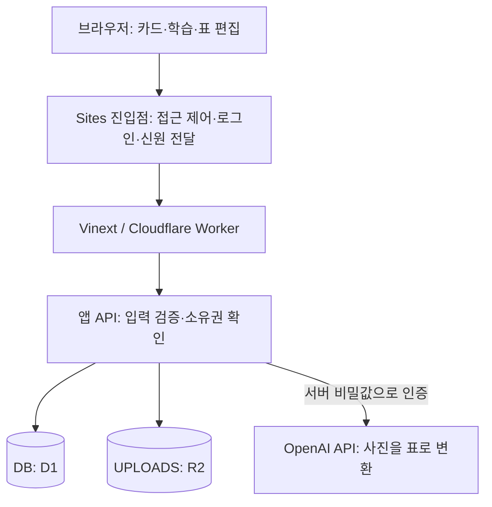

# Sites 구현 상세 목록

이 문서는 little and often에서 **Sites 플랫폼이 제공하는 기능**, **그 기능에 연결하기 위해 앱에 작성한 코드**, **일반 웹앱 코드로 만든 학습 기능**을 구분합니다. 다른 컴퓨터의 개발자가 현재 구현을 이해하거나 다른 호스팅으로 옮길 때 참고할 수 있도록 데이터 흐름과 교체 지점까지 기록합니다.

기준은 2026-11-04 GitHub로 가져온 **Sites 배포 414판**, 원본 소스 커밋 `edfaf6187b9fa637bc26df644f06afd36f6bd50f`입니다. 문서 작성은 소스와 Sites 스킬의 배포·저장소·인증 지침을 대조한 결과입니다. 운영 DB 내용이나 비밀값을 조회하거나 새로 설정한 작업은 아닙니다.

## 1. 전체 목록

| 항목 | 사용자가 얻는 기능 | Sites와 앱의 역할 | 구현 상태 |
| --- | --- | --- | --- |
| Site 식별·주소 | 같은 주소로 앱 접속 | Sites가 주소·배포를 관리하고 앱이 Site ID 선언 | 사용 중 |
| 접근 제어·인증 정보 | 허용된 사용자가 자기 자료 이용 | Sites가 접근·로그인을 처리하고 API가 전달된 신원 확인 | 사용 중 |
| 로그인 보조 함수 | 로그인·로그아웃 URL 생성, 이름 해석 | 스타터에 포함된 서버 도우미 | 코드 존재, 현재 홈의 직접 호출은 없음 |
| 서버 실행 | 브라우저와 같은 프로젝트에서 API 제공 | Vinext로 빌드하고 Workers에서 실행 | 사용 중 |
| D1 연결 | 카드·정오답·세트·진도 영구 저장 | Sites가 DB 바인딩, 앱이 스키마·쿼리 구현 | 사용 중 |
| 개인 데이터 분리 | 다른 사용자의 카드·사진과 분리 | 인증 헤더 + 앱의 소유자 조건 | 사용 중 |
| 이어하기·기록 재전송 | 기기 간 진행 복원, 통신 실패 후 기록 재시도 | D1은 서버 저장, 앱은 큐·중복 방지 구현 | 사용 중 |
| R2 사진 저장 | 카드에 사진 첨부·조회 | Sites가 파일 저장소 바인딩, 앱이 업로드·조회 구현 | 사용 중 |
| 서버 비밀값 | 브라우저에 키를 넣지 않고 외부 API 사용 | Sites 런타임 값 + 서버 전용 접근 | 연결 코드 존재, 실제 값은 문서 대상에서 제외 |
| 사진→표 | 사진을 편집 가능한 셀 구조로 변환 | 앱의 OpenAI 호출이 Sites 서버에서 실행 | API 키가 있을 때 사용 가능 |
| DB 마이그레이션 | 업데이트 후에도 새 스키마로 앱 이용 | 앱이 SQL 생성·포함, Sites 배포가 호스팅 DB에 적용 | 사용 중 |
| 빌드·패키징 | 소스·배포 설정·마이그레이션을 묶어 배포 | 저장소의 빌드 플러그인과 외부 Sites 도구 | 사용 중 |
| 버전 저장·배포·상태 확인 | 배포판 식별과 이전 소스 추적 | Sites 관리 기능, 앱 UI 기능은 아님 | 이 프로젝트 배포에 사용 |
| 로컬 미리보기 | 운영과 분리하여 화면·API 개발 | Vite·Miniflare와 논리 바인딩 설정 | 구성 있음 |
| 이미지 최적화 경로 | `/_vinext/image` 요청 처리 | Workers 엔트리의 스타터 코드 | 코드 존재, 실제 이미지 서비스 바인딩 활성화는 미확인 |
| 앱 아이콘·홈 화면 표시 | 모바일에서 앱처럼 열기 | 표준 웹 매니페스트·메타데이터 | 구현됨, Sites 독점 기능은 아님 |

**Sites 스킬은 개발·배포를 수행하는 에이전트의 작업 지침입니다.** 사용자의 브라우저 안에서 스킬이 실행되는 구조는 아닙니다. 실행 중인 서비스는 저장소의 React·TypeScript 코드와 서버 API이며, Sites는 그 실행·접근·저장 환경을 연결합니다.

## 2. 요청과 데이터가 이동하는 구조



`/api/cards` 같은 주소는 별도 외부 백엔드 주소가 아니라 같은 Site의 서버 경로입니다. 브라우저는 API 키·DB 연결 비밀번호를 전달하지 않습니다. 서버는 플랫폼이 제공한 인증 정보와 런타임 바인딩으로 필요한 자원에 접근합니다.

## 3. Site ID·주소·배포 설정

**관련 코드:** [`.openai/hosting.json`](../.openai/hosting.json), [`app/layout.tsx`](../app/layout.tsx)

현재 선언은 다음과 같습니다.

```json
{
  "d1": "DB",
  "project_id": "appgprj_6a8fc68e2f948191af15465a8837e5b6",
  "r2": "UPLOADS"
}
```

- `project_id`는 기존 Site의 식별자입니다. 이 값을 사용해 기존 소스·배포판과 연결합니다.
- `d1`·`r2`는 코드에서 읽을 **논리 바인딩 이름**입니다. DB 비밀번호나 실제 버킷의 접속 URL이 아닙니다.
- 현재 구성은 Worker 서버형이므로 정적 파일 전용 호스팅을 뜻하는 `static.directory`가 없습니다.
- 서비스 주소는 `https://teacher-study-cards.seungbeen.chatgpt.site/`입니다. 메타데이터의 기준 URL도 해당 주소로 설정되어 있습니다.

접근 허용 사용자·그룹, 비밀값, 실제 자원 배치 정보는 이 파일만으로 복원되지 않습니다. GitHub에 이 파일이 있어도 동일한 운영 DB나 로그인 권한이 자동으로 생성되는 것은 아닙니다.

**다른 호스팅으로 옮길 때:** Site ID 대신 새 서비스의 배포 구성을 만들고 도메인·메타데이터 기준 주소를 바꿉니다. 기존 서비스를 계속 업데이트할 때는 Site ID와 바인딩 이름을 임의로 바꾸지 않습니다.

## 4. 로그인·접근 제어와 실제 API의 신원 확인

**관련 코드:** [`lib/auth.ts`](../lib/auth.ts), [`app/chatgpt-auth.ts`](../app/chatgpt-auth.ts), [`app/page.tsx`](../app/page.tsx)

Sites는 호스팅된 요청의 인증 경계를 관리하고 로그인한 사용자의 신원을 헤더로 전달합니다. 앱에서 쓰는 이름은 다음과 같습니다.

| 헤더 | 용도 | 현재 사용 위치 |
| --- | --- | --- |
| `oai-authenticated-user-email` | 기존 카드 데이터의 소유자 식별 | 대부분의 카드·학습 API |
| `oai-authenticated-user-id` | Site 안에서 안정적인 사용자 ID | 표 템플릿, 목표 날짜 API |
| `oai-authenticated-user-full-name` | 선택적인 표시 이름 | 로그인 도우미가 해석 가능 |
| `oai-authenticated-user-full-name-encoding` | 이름 인코딩 구분 | `percent-encoded-utf-8`일 때 디코딩 |

현재 실제 API의 대부분은 `getOwnerEmail(request)`로 이메일을 얻고, 없으면 `unauthorized()`로 HTTP 401과 오류 메시지를 반환합니다. 템플릿·날짜 API는 사용자 ID를 직접 읽습니다.

`app/chatgpt-auth.ts`에는 다음 서버 보조 함수가 있습니다.

- `getChatGPTUser()`: 헤더를 읽어 사용자 표시 정보를 구성합니다. 이름이 없거나 디코딩할 수 없으면 이메일을 표시 이름으로 사용합니다.
- `requireChatGPTUser(returnTo)`: 신원이 없을 때 로그인 URL로 리다이렉트하는 함수입니다.
- `chatGPTSignInPath()`·`chatGPTSignOutPath()`: 로그인·로그아웃 URL을 만듭니다.
- 반환 경로는 같은 출처의 상대 경로인지 확인하고, 외부 주소·인증 예약 경로 등을 배제합니다.

**호출 여부 구분:** 현재 `app/page.tsx`는 `dynamic = "force-dynamic"`으로 홈을 렌더링하지만 `requireChatGPTUser()`를 직접 호출하지 않습니다. 따라서 모든 요청이 이 도우미를 거쳐 로그인된다고 설명하면 부정확합니다. 현재 접근 경계는 플랫폼의 Site 접근 설정과 각 API의 신원 확인으로 보아야 합니다.

`/signin-with-chatgpt`, `/signout-with-chatgpt`, `/callback`은 플랫폼이 처리하는 예약 경로입니다. 저장소에 자체 OAuth 서버나 해당 경로의 처리기를 만든 구조가 아닙니다. 이 도우미를 UI에서 사용할 경우에는 플랫폼 지침대로 최상위 페이지 이동으로 로그인을 시작해야 합니다.

**이관 시:** 외부 요청의 헤더를 그대로 믿으면 안 됩니다. 새 인증 계층이 검증한 사용자만 서버에 전달하도록 만들고, 기존 이메일 기반 기록과 사용자 ID 기반 기록을 각각 새 계정에 연결해야 합니다. Site 사용자 ID를 다른 Site에서도 그대로 쓸 수 있다고 가정하지 않습니다.

## 5. 사용자별 자료를 분리하는 방식

**관련 코드:** [`db/schema.ts`](../db/schema.ts), [`app/api/cards/route.ts`](../app/api/cards/route.ts), [`app/api/sets/route.ts`](../app/api/sets/route.ts), [`app/api/table-templates/route.ts`](../app/api/table-templates/route.ts), [`app/api/settings/day/route.ts`](../app/api/settings/day/route.ts)

Sites의 로그인은 사용자가 누구인지를 전달합니다. 어떤 자료를 읽고 바꿀 수 있는지는 앱의 쿼리가 별도로 제한합니다.

1. API에서 로그인 정보를 얻습니다.
2. 목록 조회에 소유자 조건을 넣습니다.
3. 카드 수정·세트 구성 등에서는 요청한 카드가 같은 소유자의 자료인지 확인합니다.
4. 사진을 연결할 때도 해당 이미지 ID가 사용자 소유인지 검사합니다.
5. 신원이 없거나 소유권이 맞지 않으면 작업을 거부합니다.

현재 카드·사진·복습·키워드 통계·연결 기록·학습 진도·세트는 주로 `owner_email`을 사용합니다. 표 템플릿과 목표 날짜는 `owner_id`를 사용합니다. 이는 같은 프로젝트 안에 두 가지 소유자 식별 방식이 함께 있다는 뜻이며, 앱 전체가 이미 사용자 ID 방식으로 통일된 것은 아닙니다.

**유지보수 시:** 새 테이블은 안정적인 사용자 ID 사용을 검토하되, 기존 이메일 데이터의 소유자 값을 단순 치환하면 기록 연결이 끊길 수 있으므로 매핑·마이그레이션 계획이 필요합니다. 로그인과 Site에 접근할 수 있는 권한도 구분해야 합니다.

## 6. D1 데이터베이스와 저장 구조

**관련 코드:** [`db/index.ts`](../db/index.ts), [`db/schema.ts`](../db/schema.ts), [`types/cloudflare-env.d.ts`](../types/cloudflare-env.d.ts)

Sites는 manifest의 `d1: "DB"`에 대응하는 호스팅 자원을 연결합니다. 앱은 서버에서 `env`를 `cloudflare:workers`로부터 가져와 `env.DB`를 읽습니다.

- `getDb()`는 `drizzle(env.DB, { schema })`로 Drizzle 접근 객체를 만듭니다.
- `getRawDb()`는 D1의 준비된 SQL과 배치를 직접 사용할 때 원래 바인딩을 반환합니다.
- DB 바인딩이 없으면 연결 문자열을 추측하지 않고 오류를 냅니다.
- Worker 전용 타입은 별도 선언으로 한정해 브라우저 DOM 타입과 충돌하지 않게 합니다.

| 데이터 | 저장 위치와 의미 |
| --- | --- |
| 카드 | `cards`: 질문·답·서식·메모·분류·섹션·정오답·보관·단계 |
| 복습 | `reviews`: 결과, 입력 답, 학습 종류, 힌트, 전체/부분 범위, 이벤트 ID |
| 키워드 | `keyword_stats`, `keyword_attempt_events`: 키워드별 성적과 중복 전송 식별 |
| 연결 학습 | `connection_stats`, `connection_attempt_events` |
| 세션 | `study_runs`: 완료 기록과 소요 시간 |
| 이어하기 | `study_progress`: 문맥별 다음 카드·남은 순서·실전/연습 |
| 세트 | `study_sets`, `study_set_cards`: 세트와 순서 있는 카드 연결 |
| 사진 메타데이터 | `card_images`: 소유자·형식·크기. 사진 바이트는 R2 |
| 표 템플릿 | `table_templates`: 사용자별 이름과 표 문서 |
| 목표 날짜 | `day_settings`: 사용자별 목표 날짜 |

표는 별도의 카드 테이블을 만들지 않고 `cards.answer_format`에 `[table:v1]`로 시작하는 JSON 문서를 저장합니다. 셀·키워드 ID와 병합·음영·정렬·열 너비를 함께 보존합니다. 이 저장 형식은 앱 설계이며 Sites가 자동으로 정의한 기능이 아닙니다.

**이관 시:** D1은 SQLite 계열이지만 `cloudflare:workers`, D1 바인딩, Drizzle D1 드라이버는 실행 환경 의존점입니다. PostgreSQL·일반 SQLite 등으로 바꾸려면 드라이버뿐 아니라 JSON SQL·배치·제약 조건과 마이그레이션을 검토해야 합니다.

## 7. 이어하기·기록 재전송·중복 방지

**관련 코드:** [`app/api/progress/route.ts`](../app/api/progress/route.ts), [`app/api/reviews/route.ts`](../app/api/reviews/route.ts), [`app/api/keyword-stats/route.ts`](../app/api/keyword-stats/route.ts), [`app/study-app.tsx`](../app/study-app.tsx)

### 서버에 남는 이어하기

`study_progress`는 소유자와 `contextKey`를 묶어 다음 카드, 학습 순서, 세션 모드와 갱신 시각을 저장합니다. POST는 복합 키 충돌 시 갱신하고 GET은 같은 사용자·문맥의 진행만 읽습니다. 다음 카드는 클라이언트의 남은 순서 계산과 결합해 복원합니다.

### 브라우저에 잠시 남는 기록

앱은 복습·세션·키워드·연결 기록의 전송 대기열을 `localStorage`에 두고, 초기 자료 로딩 후 남은 기록을 재전송합니다. 성공하면 해당 이벤트를 대기열에서 지웁니다. 모드·표 이동 방향·편집 초안 등의 기기 설정도 브라우저에 저장합니다.

이 대기열은 Sites가 제공하는 동기화 서비스가 아니라 앱이 작성한 복구 로직입니다. 서버에 도착한 기록은 D1에 남지만, 전송되지 않은 대기열은 해당 브라우저의 저장 공간에 의존합니다. 이것만으로 전체 앱의 오프라인 이용이나 모든 기기 설정의 동기화를 보장하지는 않습니다.

### 같은 결과가 두 번 올라오는 경우

`eventId`와 사용자별 고유 인덱스로 이미 받은 기록을 식별합니다. 복습 API는 기존 이벤트가 있으면 현재 결과를 돌려주고, 다른 카드에 재사용된 ID는 409로 거부합니다. 신규 복습 삽입과 카드 갱신은 배치로 묶고 삽입 여부를 확인해 카운터의 중복 증가를 막습니다. 키워드 API도 이벤트 확인·등록과 통계 갱신을 사용합니다.

Sites는 DB 실행 환경을 제공하고, 이러한 재전송·채점 정책은 앱이 책임집니다. 이관 시에는 이벤트 고유 제약과 배치 동작을 함께 보존해야 합니다.

## 8. R2 사진 업로드·조회

**관련 코드:** [`lib/card-media.ts`](../lib/card-media.ts), [`lib/card-image-storage.ts`](../lib/card-image-storage.ts), [`app/api/images/route.ts`](../app/api/images/route.ts), [`app/api/images/[id]/route.ts`](../app/api/images/[id]/route.ts)

manifest의 `r2: "UPLOADS"`를 서버의 `env.UPLOADS`로 사용합니다. 파일의 바이트는 버킷에, 소유권과 형식·크기는 D1에 나누어 저장합니다.

### 업로드 순서

1. 서버에서 사용자 이메일을 확인합니다.
2. `readImageBody()`가 요청을 읽으며 실제 크기를 세어 8MB 제한을 적용합니다. Content-Length만 믿지 않습니다.
3. 파일 바이트의 형식을 검사합니다. 일반 카드 사진은 PNG·JPEG·WebP·GIF를 받습니다.
4. 이미지 ID를 UUID로 만들고, 소유자 이메일의 SHA-256 값으로 저장 경로를 구성합니다.
5. `card-images/<소유자 해시>/<이미지 ID>`에 R2 객체를 저장합니다.
6. `card_images`에 메타데이터를 넣습니다. DB 저장이 실패하면 방금 넣은 R2 객체를 삭제하는 보상 처리를 합니다.

경로에 원본 파일명이나 이메일을 직접 넣지 않습니다. 소유자 해시는 경로 구성 방식이며, 암호화나 익명성 보장을 뜻하지 않습니다. 실제 접근 제한은 인증·소유권 검사로 수행합니다.

### 조회와 카드 연결

`GET /api/images/:id`는 ID 형식과 DB 소유권을 확인한 뒤 해당 R2 객체를 가져옵니다. 원래 바이트 스트림을 응답하고 `private, no-store`, `nosniff`, 제한적인 콘텐츠 정책을 적용합니다. 공개 버킷 URL을 브라우저에 직접 넘기는 구조가 아닙니다.

카드 저장 시 `ownsMedia()`는 첨부 ID들이 같은 소유자의 것인지 확인합니다. D1 바인딩 매개변수 수를 고려해 한 번에 80개씩 나누어 확인합니다.

**삭제 범위 구분:** 이 API에서 확인되는 R2 삭제는 업로드 후 DB 저장 실패의 보상 처리입니다. 카드 화면에서 사진 참조를 빼는 것과 버킷에서 원본을 영구 삭제하는 것은 별개이며, 일반적인 미사용 파일 자동 청소가 구현됐다고 가정하면 안 됩니다.

**이관 시:** S3 호환 저장소 등으로 파일과 메타데이터를 함께 이전하고, 업로드·인증된 다운로드·소유권 확인·실패 보상 처리를 교체합니다. DB만 옮기면 사진 원본은 따라오지 않습니다.

## 9. 런타임 비밀값과 사진→표 변환

**관련 코드:** [`app/api/table-import/route.ts`](../app/api/table-import/route.ts), [`lib/table-import.ts`](../lib/table-import.ts), [`components/table-card.tsx`](../components/table-card.tsx)

Sites의 역할은 서버 런타임에 비밀값을 공급하는 것입니다. 표를 읽는 기능 자체는 앱 서버가 OpenAI API를 호출하여 구현합니다. 자동으로 제공되는 Sites OCR 도구를 호출하는 구조가 아닙니다.

### 처리 흐름

1. 편집 화면에서 사진을 선택하고 필요하면 표 부분만 자릅니다.
2. 브라우저가 사진 데이터 URL을 같은 Site의 `/api/table-import`에 보냅니다.
3. 서버가 로그인, 요청 길이, PNG·JPEG·WebP 데이터 URL 형식을 검증합니다. 일반 카드 사진의 GIF 지원과 구분됩니다.
4. 서버가 `env.OPENAI_API_KEY`를 읽습니다. 없으면 503과 안내를 반환하며 수동 표 편집은 계속 가능합니다.
5. `https://api.openai.com/v1/responses`로 표 전사 요청을 보냅니다. 현재 코드의 모델은 `gpt-5.4-mini`이며, 이 문서는 해당 설정을 기록하는 것입니다.
6. 엄격한 JSON Schema로 행·열·셀 앵커·병합 범위·텍스트·음영·선 정보를 받습니다. 코드상 `store: false`를 지정합니다.
7. `importedTable()`이 앱의 표 문서로 변환하고 셀·키워드 ID를 새로 만들며 구조를 다시 검증합니다.
8. 사용자가 원본과 대조한 뒤 적용합니다. 사진의 굵은 글씨를 자동으로 출제 키워드로 확정하지 않습니다.

요청은 사진 안의 문구를 명령이 아닌 전사할 자료로 다루도록 지시하며, 읽기 어려운 부분은 `[?]`로 남기게 합니다. 모델 출력만 신뢰하지 않고 겹치는 셀·허용 크기 등을 앱에서 검증합니다.

키는 브라우저 입력이나 응답으로 전달하지 않고 서버에서만 사용합니다. 실제 비밀값은 GitHub·manifest·문서에 넣지 않습니다. 사진은 외부 API로 전송되고 비용이 발생할 수 있습니다. `store: false`만으로 모든 외부 데이터 처리 조건을 설명한 것으로 보아서는 안 됩니다.

**이관 시:** 새 서버의 비밀값 관리에 같은 이름을 연결하거나 서버 코드를 조정합니다. 모델 설정·한도·타임아웃·오류 처리·사용자 확인 흐름도 함께 이전합니다. 이 문서 작업에서는 키를 생성·조회하거나 API 요청을 실행하지 않았습니다.

## 10. 스키마 마이그레이션과 빌드 산출물

**관련 코드:** [`drizzle.config.ts`](../drizzle.config.ts), [`drizzle/`](../drizzle/), [`build/sites-vite-plugin.ts`](../build/sites-vite-plugin.ts)

스키마는 `db/schema.ts`, 생성 SQL과 메타데이터는 `drizzle/`에 있습니다. 현재 스냅샷에는 `0000`부터 `0022`까지의 SQL 파일과 저널·스냅샷이 포함됩니다. 예를 들어 `0021`은 단계별 성공과 힌트 필드를 추가하고 `0022`는 마지막 키워드 성공 시각을 도입합니다.

Vite에 등록한 `sites()` 플러그인은 빌드 종료 시 다음 작업을 수행합니다.

1. 생성물의 `dist/.openai` 디렉터리를 새로 준비합니다.
2. 소스의 `.openai/hosting.json`을 복사합니다.
3. `drizzle/` 전체를 `dist/.openai/drizzle/`로 복사합니다.

따라서 빌드 파일만 복사하면서 배포 메타데이터·마이그레이션을 빠뜨리는 일을 막습니다. 해당 플러그인은 SQL을 직접 실행하거나 운영 DB를 덤프하지 않습니다. **호스팅 DB의 마이그레이션 적용은 Sites 배포 과정의 역할**이며 로컬 DB 적용과도 별개입니다.

유지보수는 스키마 수정 → 마이그레이션 생성·검토 → 빌드에 포함 → 배포 순서입니다. 적용된 SQL·저널을 사후 수정하는 대신 새 마이그레이션을 추가합니다. 앱 배포 실패 전에 DB 변경이 이미 적용될 수 있으므로 소스 버전 롤백과 DB 롤백을 동일하게 취급하지 않습니다.

## 11. Workers 실행과 로컬 개발 환경

**관련 코드:** [`vite.config.ts`](../vite.config.ts), [`worker/index.ts`](../worker/index.ts), [`package.json`](../package.json), [`scripts/sites-env.sh`](../scripts/sites-env.sh)

Vite 설정은 `vinext()`, 프로젝트의 `sites()`, `@cloudflare/vite-plugin`을 함께 사용합니다. Vinext가 App Router·React 서버 코드 등을 빌드하고, Cloudflare 플러그인은 Workers 실행 환경에 연결합니다. `worker/index.ts`는 요청을 Vinext의 앱 라우터로 전달합니다.

로컬 설정에는 `DB`, `UPLOADS` 바인딩과 자리표시자 DB ID가 있습니다. 이 ID는 운영 DB 접속 정보가 아닙니다. 로컬 Miniflare/Wrangler 상태는 운영 데이터와 분리해야 합니다. 플랫폼의 인증 헤더가 없는 로컬 API 호출이 401이 되는 것도 이 구조의 결과입니다.

`scripts/sites-env.sh`는 설치·빌드 도구의 캐시·임시 파일·로그 위치를 프로젝트의 `.sites-runtime` 아래로 맞춥니다. `install-ci.sh`는 잠금 파일·무결성·설치 중복 여부와 제한 시간을 관리하고, `build-verified.sh`는 빌드 제한 시간을 둡니다. 이들은 개발 환경의 재현성을 위한 스크립트이며 학습 기능이나 사용자 비밀값 저장소가 아닙니다.

현재 스크립트는 Bash와 일부 Linux 도구를 사용하므로 README처럼 Linux/WSL을 기본으로 이해해야 합니다. 네이티브 Windows에서 도구를 직접 호출할 때는 래퍼가 제공하던 제한 시간·환경 설정이 빠지는지 확인합니다.

## 12. 버전 저장·패키징·게시의 실제 작업 방식

이 부분은 사용자 앱 코드가 아니라 Sites 스킬과 관리 도구가 담당하는 배포 절차입니다. 스킬과 보조 스크립트는 Codex 플러그인에 설치되며 이 GitHub 저장소에 전부 들어 있지는 않습니다.

1. 기존 Site ID로 현재 정보·소스 저장소 접근을 얻습니다.
2. Sites의 소스 워크플로 도우미로 체크아웃을 최신 상태로 엽니다.
3. 앱 코드·스키마를 수정하고 필요한 검사를 수행합니다.
4. 빌드 후 확정한 소스를 Sites 소스 저장소에 반영하고, 그 커밋과 일치하는 배포 아카이브를 준비합니다.
5. 커밋 SHA와 아카이브로 저장 버전을 만듭니다.
6. 기존 접근 범위에 맞는 게시 작업을 호출합니다.
7. 완료되지 않았다면 배포 ID로 상태를 확인하고, 성공한 결과의 URL을 사용합니다.

프로젝트 ID, 소스 커밋, 저장 버전 ID, 배포 ID는 서로 다른 식별자입니다. 저장된 버전이 있어도 게시에 실패할 수 있으므로 버전 번호만으로 현재 서비스에 반영됐다고 판단하지 않습니다. 이 저장소의 기준인 414판은 앞선 업로드 작업에서 게시 성공까지 확인한 버전입니다.

GitHub `main`은 이번에 만든 소스 보관·개발 경로입니다. 현재 저장소에는 GitHub push만으로 기존 Site를 자동 배포하는 Actions 구성이 없습니다. GitHub 업로드, Sites 소스 반영, 저장 버전 생성, 실제 게시를 각각 확인해야 합니다.

Site의 접근 허용 정책과 런타임 비밀값은 소스 저장소와 별도로 관리됩니다. GitHub 저장소가 공개라는 사실이 Site나 개인 학습 데이터를 공개한다는 뜻은 아닙니다.

## 13. 존재하는 코드와 실제 활성 기능의 구분

### 이미지 최적화

`worker/index.ts`에는 `/_vinext/image` 경로를 받아 `env.ASSETS`와 `env.IMAGES`로 이미지를 변환하는 스타터 코드가 있습니다. 그러나 현재 manifest는 `DB`·`UPLOADS`만 선언하고, 카드 사진은 인증된 `/api/images/:id`에서 직접 스트리밍합니다.

따라서 이미지 최적화 코드가 있다는 사실만으로 모든 카드 사진이 해당 경로를 거친다거나 운영의 `IMAGES` 바인딩이 활성화됐다고 단정하지 않습니다. 활성화하려면 실제 런타임 바인딩과 호출 경로를 확인해야 합니다.

### 모바일 앱처럼 열기

[`app/manifest.ts`](../app/manifest.ts)와 [`app/layout.tsx`](../app/layout.tsx)에 이름·아이콘·테마 색·`standalone` 표시·Apple 웹앱 메타데이터가 있습니다. 이는 표준 웹 기능이며 Sites 독점 기능은 아닙니다. 해당 파일만으로 네이티브 앱, 완전한 오프라인 캐시, 푸시 알림이 구현됐다고 설명하지 않습니다.

### 현재 사용을 확인하지 않은 플랫폼 기능

현재 manifest에는 연결 앱이나 Site MCP 서버 선언이 없고 저장소에서 별도 예약 실행 기능도 확인하지 않았습니다. 다만 예약 작업 같은 서버 외부 설정의 유무는 소스만으로 확정할 수 없습니다. 관련 기능을 이 구현의 완료 목록으로 세지 않으며, 앞으로 추가할 수 있는 플랫폼 기능과 현재 사용하는 기능을 구분해야 합니다.

## 14. 일반 앱 코드로 만든 기능 목록

다음 기능은 Sites 작업 흐름에서 개발했지만 Sites의 내장 학습 엔진이 제공한 것이 아닙니다. 다른 호스팅으로 옮겨도 UI·도메인 로직을 재사용할 수 있고, 저장·인증 호출 지점을 새 환경에 맞추면 됩니다.

| 기능 | 핵심 구현 |
| --- | --- |
| 힌트·정오답·나열형 판정 | `app/study-app.tsx`의 판정·힌트 함수와 React 상태 |
| 연습/실전·타이머·일시정지 | 같은 파일의 모드·시간 계산·입력 차단과 시계 컴포넌트 |
| 키워드 3회·전체 쓰기 2회 단계 | `lib/learning-stages.ts`, 복습 API |
| 보관·복습 간격·오답 부담 | `lib/archive-schedule.ts`, 카드·복습 API |
| 표 편집·F8·정렬 버튼 | `components/table-card.tsx`, `components/table-card.css`, `lib/table-card.ts` |
| 셀 병합·열 너비·템플릿 | 표 문서 함수와 `lib/table-template.ts` |
| 한글 입력·목록·복사 | `components/use-plain-editor-typing.ts`, `lib/editor-*` |
| 커서 노출·키보드·가로 보기 | 브라우저 viewport·selection·touch 처리와 CSS |
| 과목 색·분류 띠·오늘 완료 | 앱 UI·스타일, `lib/daily-study-stats.ts` 등 |
| 진동 | 지원 브라우저의 `navigator.vibrate` 호출 |

예를 들어 F8을 누르거나 정렬 아이콘을 누르면 같은 표 정렬 변경 함수가 문서를 갱신합니다. 표 편집의 자동 적용이 카드 저장 흐름으로 연결되고, 최종 저장은 API와 D1이 담당합니다. **정렬 규칙은 앱, 저장 환경 연결은 Sites**라는 관계입니다.

## 15. 다른 호스팅으로 옮길 때의 교체 목록

| 항목 | 유지할 부분 | 교체·이전할 부분 |
| --- | --- | --- |
| 프런트엔드 | React UI·표 문서·학습 규칙·스타일 | 새 프레임워크에 따른 서버 전용 경계 |
| 로그인 | 자료별 소유권 검사 원칙 | Sites 신원 헤더·예약 로그인 경로·계정 매핑 |
| DB | 카드·통계·세트·진도의 의미와 ID | D1 드라이버·연결·SQL 차이, 실제 데이터 |
| 파일 | 사진 ID·카드 연결·검증 정책 | R2 바인딩·버킷 객체·인증된 다운로드 |
| 비밀값 | 서버에서만 읽는 원칙 | 새 서버의 비밀값 설정 |
| AI 변환 | 사진→스키마→검증→사용자 확인 | 외부 API 연결·시간 제한·사용량 설정 |
| 배포 | 검증된 소스와 산출물의 일치 | Site ID·관리 도구·아카이브 게시 방식 |
| 마이그레이션 | 변경 이력·식별자 보존 | 새 DB 적용 절차와 호환성 검토 |
| 주소·아이콘 | 브랜드·웹 매니페스트 | 서비스 도메인·메타데이터 기준 URL |

이관 완료 여부는 소스가 실행되는지만으로 판단하지 않습니다. 같은 사용자에게 기존 카드·기록·사진이 연결되고, 재전송 이벤트가 중복 반영되지 않으며, 표 키워드 ID·진도·모드가 유지되는지 확인해야 합니다.

## 문서를 갱신할 때

플랫폼 설정과 저장소 코드는 별개로 확인합니다. 코드에 함수가 존재하는 것, 현재 화면에서 호출되는 것, 운영 환경에서 바인딩·비밀값까지 활성화된 것은 서로 다른 상태입니다. 기능을 추가하거나 호스팅을 바꿀 때는 이 목록의 구현 상태·코드 경로·이관 항목을 함께 갱신합니다.
